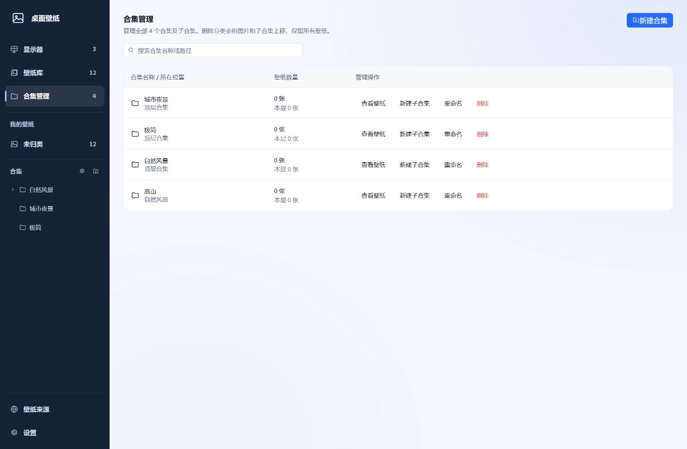
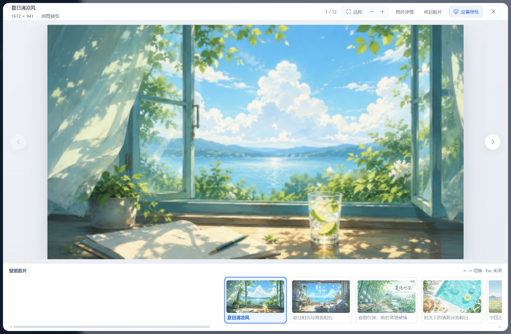
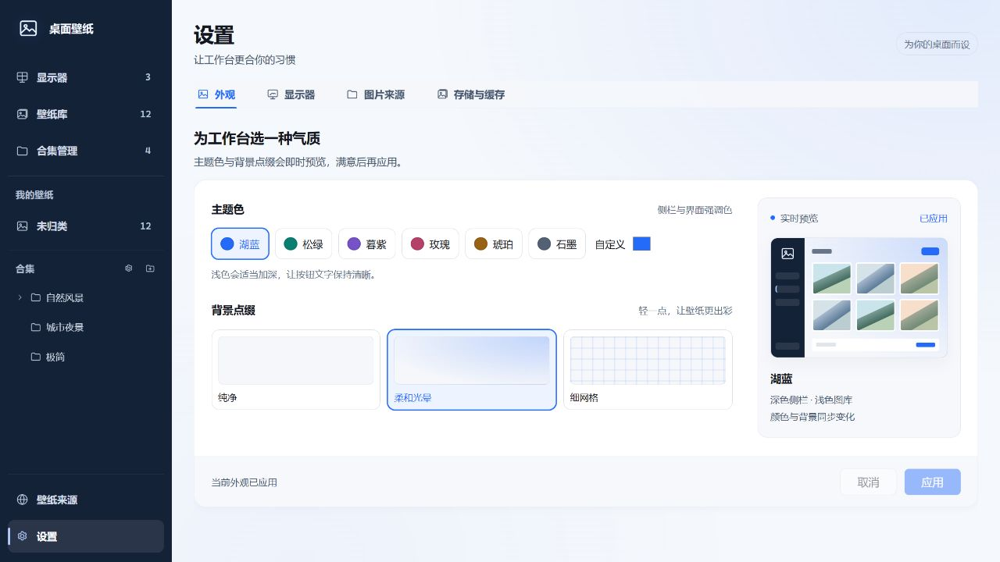
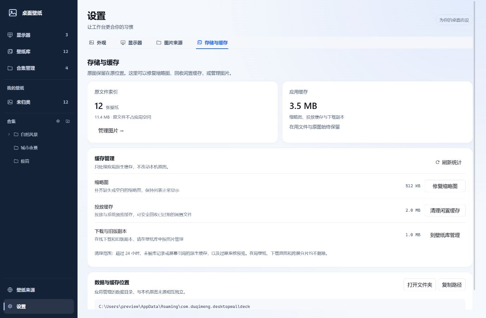

# 桌面壁纸 · Wall Deck

**看见每一块屏幕，为它选一张合适的壁纸。**

面向 Windows 的多显示器壁纸管理应用，将本地图库、真实显示器布局、原图预览与在线发现放在同一个工作台里。单击图片可以先看效果，也可以直接把图片拖到目标屏幕上应用；本机原图保留原位，由应用按需生成投放缓存。


[开始使用](#开始使用) · [显示器工作台](#显示器工作台) · [整理壁纸](#整理壁纸) · [在线发现](#在线发现) · [开发与构建](#开发与构建) · [常见问题](#常见问题)

> 截图通过 GUI 操作当前 App 的浏览器预览环境采集，与桌面版共用 React 组件和样式；显示器、来源状态、在线结果与统计值使用演示数据，不代表原生 WebView2 实测或实际在线服务内容。截图中的壁纸用于展示界面，不随安装包提供，使用与传播须遵守图片原始许可。

## 它适合怎样的桌面

- **多屏办公**：主屏、副屏、竖屏各用不同图片，按实际位置选择，不必在一串设备名称里猜目标。
- **单屏日常换图**：从自适应画廊浏览、搜索、收藏，放大看细节后再设置。
- **大量本机图片**：保留已有磁盘目录，登记来源并建立索引，再用多级合集整理。
- **偶尔换线或插拔显示器**：通过显示器身份匹配历史绑定，尽可能恢复对应壁纸；不能可靠识别时保留未绑定状态。

## 核心能力

| 你想做的事 | 应用如何完成 |
| --- | --- |
| 看清哪张图在哪块屏 | 显示器拓扑展示当前壁纸，图库卡片标注“使用中”和对应屏幕 |
| 分别设置不同屏幕 | 选图后选择目标并应用，或拖到某块屏幕后松手直接应用 |
| 多块屏幕使用同一张图 | 多选目标后应用；也可在更多操作中选择“应用到全部” |
| 一张图跨越多块屏幕 | 按真实显示器矩形裁切分片，再逐屏投放 |
| 管理已有图片文件夹 | 扫描、确认并索引原文件，不复制或改写本机原图 |
| 分类与收藏 | 多级合集、父级穿透查询、收藏筛选、名称搜索与排序 |
| 放大检查构图 | 按需原图预览、缩放、左右切换、可收起胶片条 |
| 查找在线图片 | Wallhaven、NASA、维基共享资源接口搜索、分页、下载入库 |
| 调整工作台外观 | 六种预设主题色、自定义颜色及三种背景点缀 |
| 管理磁盘占用 | 分开查看原文件索引和应用缓存，修复缩略图、清理闲置派生缓存 |

## 开始使用

### 1. 添加图片

打开默认的“壁纸库”，点击右上角 **添加壁纸** 选择本机图片。旁边的下拉菜单可以选择 **添加文件夹**：登记一个来源目录，先查看扫描结果，确认后建立索引。

支持 JPG、JPEG、PNG、WebP、BMP、GIF、TIFF、AVIF 等图片格式。这里管理的是静态图片，不是视频或网页壁纸播放器。

### 2. 浏览与预览

单击卡片只选择待应用图片，再次单击可取消选择；蓝色边框表示“当前选中”，而“使用中”标签表示系统正在使用，二者可以同时出现。双击卡片，或点击放大按钮，可以查看大图。

### 3. 选择目标并应用

到“显示器”页点击目标屏幕，选择填充方式，然后点击 **应用壁纸**。也可以直接拖动图片到目标屏幕，悬停查看预览，松手后应用。

若只想先比较图片，使用单击与大图预览；浏览本身不会自动修改桌面。

## 显示器工作台


### 自动适配真实布局

一台显示器展示一台，两台展示两台，三台展示整组。画布读取系统返回的位置与尺寸，等比绘制横排、上下排列、竖屏及错位布局，并在可用空间里尽量放大全部屏幕。

当前工作台采用一套自动适配布局，不再提供“紧凑 / 详细”切换，也不使用横向滚动的放大画布。窗口大小或连接屏幕数量变化后，会自动重新计算整组屏幕的统一缩放比例。

- **上方以显示器为主角**：全部目标同时可见，保留每块屏幕的真实宽高比、相对位置与主屏标记。
- **右侧负责当前操作**：显示待选壁纸、目标多选、填充方式和应用按钮；无有效选择时禁用应用。
- **下方用于继续选图**：展示全部候选壁纸，不继承壁纸库页面的合集过滤；图库独立滚动。
- **预览与实际状态分开**：单击图片后，选中屏幕显示待应用预览；卡片的“使用中”标签仍反映实际桌面，应用成功后再更新。
- **状态变化不挤动页面**：选中、取消、换图和裁切提示显隐时，顶部占位保持稳定。

需要更多图库空间时，点击 **收起布局**。顶部变成缩略概览与紧凑投放区，继续保留目标选择、填充方式和应用入口；再次展开恢复完整拓扑。


### 选图与应用是两个动作

| 操作 | 结果 |
| --- | --- |
| 单击壁纸卡片，或按 Enter / 空格 | 选择或取消选择；不投放 |
| 在显示器页选择图片及目标 | 在选中屏幕预览待应用图片；点击应用后生效 |
| 拖动图片到屏幕并悬停 | 显示目标预览，不修改桌面 |
| 在有效屏幕目标上松手 | 直接应用到落点屏幕 |
| 按住 Shift，拖到已多选集合中的屏幕 | 应用到当前已选且在线的屏幕 |
| Esc、窗口失焦或松手落在空白处 | 取消拖动 |
| 资源管理器中的单张图片拖到屏幕 | 先索引，再只应用到落点屏幕，不扩展到多选集合 |
| 多张图片拖到图库 | 批量建立索引，不修改桌面 |

目标屏幕可在设置卡中多选；在拓扑中按住 Ctrl 点击可追加选择。没有有效目标时，“应用壁纸”不可用，不会自动回退为全部屏幕。

### 填充方式与多屏投放

支持 **填充、适应、拉伸、居中、平铺**。有裁切说明时，“填充方式”旁显示提示图标，可通过悬停、键盘聚焦或点击查看，不撑高设置卡。

“更多投放操作”提供 **应用到全部** 和 **跨屏拼接**。前者统一设置全部屏幕；后者按各块屏幕的真实几何位置裁切同一张图。

平铺属于 Windows 的系统全屏模式，不能只应用到一块屏幕，因此禁用单屏拖放与单屏应用；需要时从更多操作应用到全部。

### 显示器变化

应用监听显示器拓扑变化，延迟重新枚举后按历史身份映射恢复绑定，避免使用拔插过程中的中间状态。可通过“刷新显示器”或设置页的“重新检测”手动重读。

虚拟显示器默认不参与主流程，可在 **设置 → 显示器** 中开启显示；即使当前未检测到虚拟屏，也能提前保存偏好。显示器身份可能受硬件、驱动和序列号可用性影响，无法可靠匹配时不会静默套用其他屏幕的壁纸。

## 整理壁纸

### 自适应画廊

图库列数随窗口可用宽度增加或减少，卡片保持固定高度，图片列表独立滚动。顶部提供名称搜索、当前目录收藏筛选、最近添加 / 名称 / 分辨率排序，以及网格与列表视图切换。

卡片菜单可查看图片详情、移到合集、重新定位原文件，或从库中移除。详情区分文件创建时间、修改时间与入库时间，并提供在资源管理器中定位的入口。

### 来源目录与合集各管一件事



- **来源目录**：磁盘上的真实文件夹，负责扫描并发现新增或变化的图片。
- **合集**：应用内的虚拟分类，移动图片到合集不会移动磁盘文件。

合集支持多级嵌套；浏览父合集可包含子合集中的图片。删除合集只取消分类：其中壁纸与直接子合集上移一级，顶级壁纸回到未归类，不连带删除图片。

来源目录在应用启动或手动刷新时扫描，**不做实时文件监听**。原图缺失时保留记录，支持单张重新定位；整个来源目录搬迁后，可在 **设置 → 图片来源** 中重新定位来源。

从壁纸库移除一张索引图片后，后续来源重扫不会自动加回；显式重新添加同一文件可解除忽略。取消来源关联则保留已有索引图片，不删除原文件。

## 沉浸式大图预览



原图在打开预览时按需读取，图库日常滚动使用缩略图。支持适应窗口、原始尺寸、放大、缩小，以及左右方向键浏览；胶片条可收起，为图片留出更多空间。

预览头部的 **设置壁纸** 会打开浮动面板，与主界面共用目标屏幕和填充方式。切换图片只同步待选状态，不会投放。Esc 优先关闭子菜单或设置面板，再关闭大图；焦点会恢复到原入口。

## 在线发现


| 来源 | 当前接入方式 |
| --- | --- |
| Wallhaven | 公开接口搜索与分页，默认安全级别内容 |
| NASA 影像 | 公开接口搜索、下载入库 |
| 维基共享资源 | 公开接口搜索，保留作品来源与许可信息 |
| Unsplash | 官网入口；当前未配置应用密钥 |
| Pexels | 官网入口，未接入自动图库 |
| Desktopography | 官网入口，未接入自动图库 |

在线图库通过后端适配来源接口，**不内嵌第三方网页，也不抓取任意网页**。支持加载、空结果、失败重试和分页；下载后可以加入本地壁纸库，再离线使用。

下载地址由后端向来源重新解析，并受 HTTPS 域名白名单、超时和 50MB 单文件上限约束。来源、作者及许可信息随记录保存；免费可访问不等于无版权，使用与署名要求以作品原页为准。

## 外观与维护

### 外观



深色侧栏搭配浅色图库，提供六种预设主题色、自定义颜色，以及“纯净 / 柔和光晕 / 细网格”背景点缀。修改可即时预览，点击 **应用** 后保存；取消或离开该分类会恢复已应用的外观。

主题色不改变危险、成功和警告语义色。动画尊重系统“减少动态效果”设置；当前不提供全应用暗色模式。

### 存储与缓存



本机原文件仍在原目录，索引大小不等于应用占用。应用的数据目录通常位于：

```text
%APPDATA%\com.duqimeng.desktopwalldeck
```

可在 **设置 → 存储与缓存** 复制路径或打开数据目录，以界面实际显示路径为准。

| 数据 | 用途 |
| --- | --- |
| `library.db` | 壁纸索引、来源、合集和显示器绑定 |
| `thumbs/` | 后台生成的缩略图 |
| `rendered/<id>/<version>.jpg` 或 `.png` | 投放缓存；一般 JPEG 质量 92，含透明通道时保留 PNG |
| `previews/` | 系统当前壁纸的预览缓存 |
| `files/` | 在线下载及旧版托管副本 |
| `span/` | 跨屏拼接分片 |

**修复缩略图** 只补齐缺失或 0 字节的缩略图，不承诺检测所有内容损坏的图片。

**清理闲置缓存** 需要确认，仅处理 `previews/`、`thumbs/`、`rendered/` 中至少 24 小时未修改且未被引用的普通 JPG / JPEG / PNG 派生文件。清理前读取当前系统壁纸，读取失败会拒绝清理；仍被库、显示器绑定或当前桌面使用的文件会保留，不跟随符号链接或目录联接。

清理不会删除本机原图、下载原图、跨屏分片、数据库或索引；结果会报告删除数量、释放空间、跳过和失败项。

## 开发与构建

### 环境准备

开发面向 Windows 10 / 11，需要 Node.js 与 npm、Rust 的 MSVC 工具链、Visual Studio C++ 构建工具，以及 WebView2 运行时。`Cargo.toml` 声明的最低 Rust 版本为 1.77；完整依赖能否编译以实际工具链检查为准。

```powershell
npm ci
npm run tauri dev
```

首次运行需要下载并编译 Rust 依赖。只启动前端开发服务可使用 `npm run dev`，但生产入口依赖 Tauri IPC，不能将普通浏览器打开视为完整桌面运行。

### 生产构建

```powershell
npm run tauri build
```

构建产物位于：

- `src-tauri/target/release/desktop-wall-deck.exe`：可执行文件。
- `src-tauri/target/release/bundle/nsis/`：Windows 安装包。

产物名称和大小随版本与构建配置变化。首次打包可能需要下载 NSIS 工具链；只生成可执行文件可使用 `npm run tauri build -- --no-bundle`。

### 常用检查

```powershell
npm run build
cargo check --manifest-path src-tauri/Cargo.toml
cargo test --manifest-path src-tauri/Cargo.toml --lib
```

真实图片索引与投放缓存格式回归可单独运行：

```powershell
cargo test --manifest-path src-tauri/Cargo.toml --test e2e_import
```

`e2e_import` 使用测试中约定的本机样本，样本不存在时自动跳过。`e2e_apply` 会真实修改桌面壁纸，结束后尝试恢复，不应在普通回归中执行。未加筛选的完整 `cargo test` 会包含该测试。

UI 回归使用本地浏览器预览 harness：为 Tauri 调用提供桩数据，渲染同一份 App。harness 与测试数据不入库，不能代替原生 WebView2 或真实 COM 投放验证。本文配图位于 `docs/images/`，属于用于产品文档的显式例外；日常调试截图仍留在忽略目录。

### 项目结构与实现要点

| 层 | 技术 |
| --- | --- |
| 桌面外壳 | Tauri 2 |
| 前端 | React 19、TypeScript、Vite |
| 界面动效 | Motion for React，按需加载 |
| Windows 壁纸接口 | Rust、`windows` crate、COM `IDesktopWallpaper` |
| 持久化 | SQLite，`rusqlite` bundled |
| 图像处理 | `image`、`kamadak-exif` |

```text
src/
  components/      拓扑、图库、预览、设置卡和通用弹层
  hooks/           数据、拖放与缩略图事件
  lib/             IPC、类型、主题与来源配置
  views/           主界面、合集、在线来源与设置
  styles/          工作区与组件样式
src-tauri/src/
  wallpaper/       STA 壁纸线程与 Windows 系统适配
  library/         索引、扫描、合集、缩略图与缓存
  online.rs        在线来源适配和受限下载
  preview_cache.rs 系统壁纸预览缓存
  commands.rs      Tauri 命令入口
```

壁纸 COM 接口统一在单一 STA actor 线程中串行执行；“应用到全部”使用系统全屏语义，跨屏拼接则本地切片后逐屏设置。系统壁纸可能位于无扩展名或不在资源白名单内的路径，因此预览走后端解码，不扩大原图目录访问范围。

开发约束、命令注册、显示器身份、缓存清理与布局稳定性规范见 [AGENTS.md](AGENTS.md)。应用图标的矢量源文件位于 [src/assets/app-icon.svg](src/assets/app-icon.svg)。

## 常见问题

**为什么找不到新放进文件夹的图片？**

来源不是实时监听。启动时会扫描，也可手动刷新或到“设置 → 图片来源”重新扫描。

**删除合集或取消来源关联，会删除原图吗？**

不会。合集是虚拟分类，来源关联负责扫描。本机原图保持原位；从库中移除索引也不会删除本机原图。

**原文件搬家或移动硬盘离线后怎么办？**

缺失记录仍会保留，可重新定位图片或整个来源。缺失原图时禁止重新投放；已在桌面使用的缓存不因移除索引而自动删除。

**为什么原图比例和屏幕不一致？**

选择“填充”可能裁切，“适应”可能留边；“拉伸”会改变图片比例。裁切提示可在填充方式旁查看，浏览原图与最终桌面构图也可能不同。

**为什么在线图库没有结果？**

可能是关键词、网络、来源服务或限流。可重试、更换关键词、切换来源，或打开来源官网。官网入口不表示已接入应用内搜索。

**能使用视频或 HTML 动态壁纸吗？**

当前仅支持静态图片壁纸。

**显示器重新插入后一定能恢复吗？**

恢复依赖设备可用身份与历史绑定；序列号缺失、驱动或连接方式变化可能影响识别，无法匹配时需要重新选择目标。

**能在 macOS 或 Linux 使用吗？**

当前壁纸投放依赖 Windows COM，未提供其他平台适配。旧版 Windows 的兼容性也需要单独验证，不能仅凭底层 API 的最低版本保证应用可运行。
